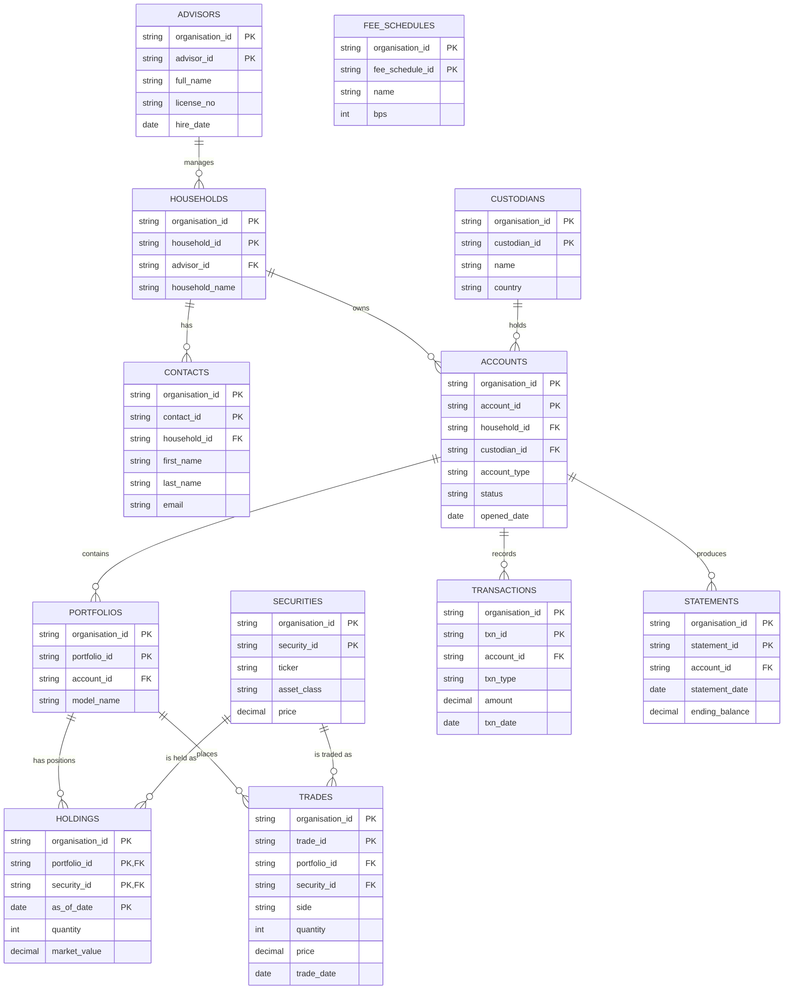
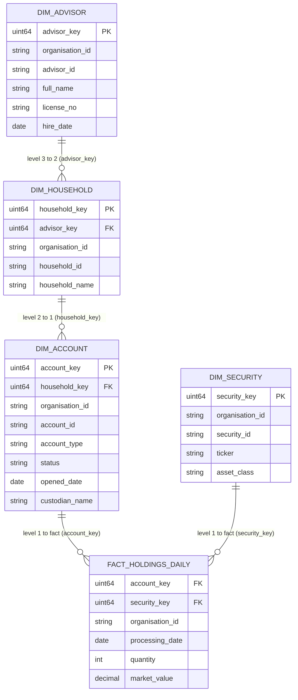
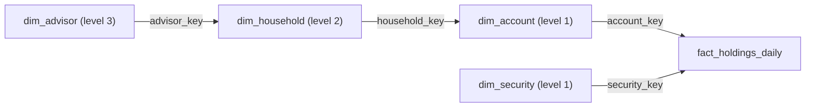
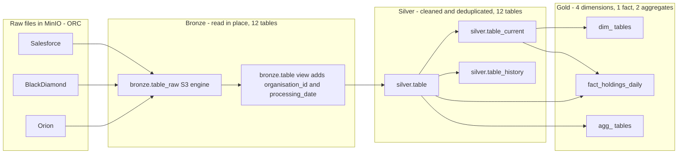

# Data Catalog: Bronze, Silver, Gold

Wealth-management Medallion pipeline on MinIO, ClickHouse and Airflow. All data is synthetic: 3 organisations (`org_8812`, `org_4410`, `org_7305`), 7 daily files (2026-08-25 to 2026-08-31), 12 source tables.

## Contents

1. Data models
2. Architecture and conventions
3. Bronze catalog
4. Silver catalog
5. Gold catalog
6. Lineage
7. Quality and multi-tenancy rules
8. Glossary

Start with section 1: the data models show how the tables relate. The later sections catalog each layer table by table.

## 1. Data models

### 1.1 OLTP model (normalized, 3NF)

This is the operational model of the source systems, and what Silver stores. Each fact is stored once, linked by keys, so a change (an account status, an advisor) is made in one place. Good for correct, consistent records; slow and awkward for reporting because answering one question needs many joins.

Every entity also carries `organisation_id` as part of its key, so the same business key in two organisations (for example `ACC-9999`) stays as two different rows.

### 1.2 OLAP model (snowflake schema)

This is the analytical model in Gold, built as a **snowflake schema**: the dimensions are normalized into levels instead of all pointing at the fact. The fact table `fact_holdings_daily` holds the measures (`quantity`, `market_value`) at one row per organisation, day, account and security, and has only two keys: `account_key` and `security_key`. `dim_account` and `dim_security` are level 1 (they connect to the fact). `dim_household` is level 2 (it connects to `dim_account`), and `dim_advisor` is level 3 (it connects to `dim_household`). Each description is stored once, so a change to an advisor is made in one row. The cost is more joins: AUM per advisor goes fact -> account -> household -> advisor. A star schema would instead put `household_key` and `advisor_key` directly on the fact; this project keeps the snowflake on purpose.

How the levels connect:

The two aggregate tables (`agg_aum_by_org_assetclass_day`, `agg_trading_by_org_day`) are pre-summed copies of the same data for fast dashboards. They are keyed by organisation, day and asset class or side.

### 1.3 OLTP and OLAP side by side

|  | OLTP (Silver) | OLAP (Gold) |
|---|---|---|
| Purpose | Record and update business events correctly | Answer questions over many rows |
| Where here | Silver (and the source systems) | Gold |
| Shape | Many narrow tables, 3NF, little repetition | Fact plus dimensions in levels (snowflake schema), little repetition |
| Keys | Business keys + organisation_id | Surrogate keys + organisation_id |
| History | Day by day rows, `_current` and `_history` views | Current state in dimensions, daily grain in the fact |
| Typical query | Look up one account and its owner | Total assets per organisation, per day, per asset class |
| Joins per question | Many | Some (follow the dimension chain) |

## 2. Architecture and conventions

| Convention | Rule |
|---|---|
| Tenant key | `organisation_id` is in every table and every key. Every join and every `GROUP BY` must include it (enforced by guard tests). |
| Partitions | Files land at `bronze/<source>/<table>/<organisation_id>/<YYYY-MM-DD>/data.orc`. The organisation and date are read from the path, not from the file. |
| Silver grain | 1 row per organisation + business key + day. |
| Dedup rule | Keep the row with the newest `updated_at` for each key. |
| Surrogate keys | Gold dimensions use `sipHash64(organisation_id, business key)` as a stable key. Facts compute the same key. |
| Naming | `dim_` dimension, `fact_` fact, `agg_` aggregate, `_current` latest state view, `_history` change view, `_v` read view. |
| Refresh | Airflow DAG `medallion_pipeline` (manual trigger). Bronze, then Silver, then Gold. |

## 3. Bronze catalog

Bronze keeps raw data exactly as delivered. It is not copied: ClickHouse reads the ORC files in MinIO in place. For every table there are two objects: `bronze.<table>_raw` (S3 engine) and `bronze.<table>` (a view that adds the two partition columns).

| Table | Source system | Meaning | MinIO path |
|---|---|---|---|
| `bronze.households` | Salesforce | A family or client unit that owns accounts and has contacts. | `salesforce/households/<org>/<date>/data.orc` |
| `bronze.contacts` | Salesforce | A person belonging to a household. | `salesforce/contacts/<org>/<date>/data.orc` |
| `bronze.accounts` | Salesforce | An investment account owned by a household and held at a custodian. | `salesforce/accounts/<org>/<date>/data.orc` |
| `bronze.advisors` | Salesforce | A financial advisor who manages households. | `salesforce/advisors/<org>/<date>/data.orc` |
| `bronze.custodians` | Blackdiamond | The firm that holds the assets (Schwab, Fidelity, Pershing). | `blackdiamond/custodians/<org>/<date>/data.orc` |
| `bronze.portfolios` | Blackdiamond | The investment portfolio inside an account. | `blackdiamond/portfolios/<org>/<date>/data.orc` |
| `bronze.securities` | Blackdiamond | A tradable security (stock, ETF, bond fund) with its daily price. | `blackdiamond/securities/<org>/<date>/data.orc` |
| `bronze.holdings` | Blackdiamond | Quantity and value of a security in a portfolio, one row per day. | `blackdiamond/holdings/<org>/<date>/data.orc` |
| `bronze.trades` | Orion | A buy or sell of a security in a portfolio. | `orion/trades/<org>/<date>/data.orc` |
| `bronze.transactions` | Orion | A cash movement on an account (deposit, withdrawal, fee, dividend). | `orion/transactions/<org>/<date>/data.orc` |
| `bronze.fee_schedules` | Orion | Advisory fee rates (reference data). | `orion/fee_schedules/<org>/<date>/data.orc` |
| `bronze.statements` | Orion | A daily account statement with the ending balance. | `orion/statements/<org>/<date>/data.orc` |

### bronze.households

A family or client unit that owns accounts and has contacts. Source: Salesforce.

| Column | Type | Key | Description |
|---|---|---|---|
| organisation_id | String | partition | Tenant (customer firm). Part of every key; never joined or grouped without it. |
| processing_date | Date | partition | Date of the daily file the row came from. |
| household_id | String |  | Household identifier (e.g. HH-0001). |
| household_name | String |  | Display name of the household. |
| advisor_id | String |  | Advisor responsible for the household. |
| updated_at | DateTime |  | When the row was last changed. The newest value wins when Silver removes duplicates. |

### bronze.contacts

A person belonging to a household. Source: Salesforce.

| Column | Type | Key | Description |
|---|---|---|---|
| organisation_id | String | partition | Tenant (customer firm). Part of every key; never joined or grouped without it. |
| processing_date | Date | partition | Date of the daily file the row came from. |
| contact_id | String |  | Contact identifier (e.g. CON-0001). |
| household_id | String |  | Household identifier (e.g. HH-0001). |
| first_name | String |  | Contact first name. |
| last_name | String |  | Contact last name. |
| email | String |  | Contact email. Changes are tracked. |
| updated_at | DateTime |  | When the row was last changed. The newest value wins when Silver removes duplicates. |

### bronze.accounts

An investment account owned by a household and held at a custodian. Source: Salesforce.

| Column | Type | Key | Description |
|---|---|---|---|
| organisation_id | String | partition | Tenant (customer firm). Part of every key; never joined or grouped without it. |
| processing_date | Date | partition | Date of the daily file the row came from. |
| account_id | String |  | Account identifier (e.g. ACC-0001). Unique only inside one organisation. |
| household_id | String |  | Household identifier (e.g. HH-0001). |
| custodian_id | String |  | Custodian identifier (e.g. CUS-01). |
| account_type | String |  | IRA, JOINT, TRUST or INDIVIDUAL. |
| status | String |  | ACTIVE, DORMANT or CLOSED. Changes over time, so history is tracked. |
| opened_date | Date |  | Date the account was opened. |
| updated_at | DateTime |  | When the row was last changed. The newest value wins when Silver removes duplicates. |

### bronze.advisors

A financial advisor who manages households. Source: Salesforce.

| Column | Type | Key | Description |
|---|---|---|---|
| organisation_id | String | partition | Tenant (customer firm). Part of every key; never joined or grouped without it. |
| processing_date | Date | partition | Date of the daily file the row came from. |
| advisor_id | String |  | Advisor identifier (e.g. ADV-001). |
| full_name | String |  | Advisor full name. |
| license_no | String |  | Advisor licence number. |
| hire_date | Date |  | Date the advisor was hired. |
| updated_at | DateTime |  | When the row was last changed. The newest value wins when Silver removes duplicates. |

### bronze.custodians

The firm that holds the assets (Schwab, Fidelity, Pershing). Source: Blackdiamond.

| Column | Type | Key | Description |
|---|---|---|---|
| organisation_id | String | partition | Tenant (customer firm). Part of every key; never joined or grouped without it. |
| processing_date | Date | partition | Date of the daily file the row came from. |
| custodian_id | String |  | Custodian identifier (e.g. CUS-01). |
| name | String |  | Name of the custodian or fee schedule. |
| country | String |  | Country of the custodian. |
| updated_at | DateTime |  | When the row was last changed. The newest value wins when Silver removes duplicates. |

### bronze.portfolios

The investment portfolio inside an account. Source: Blackdiamond.

| Column | Type | Key | Description |
|---|---|---|---|
| organisation_id | String | partition | Tenant (customer firm). Part of every key; never joined or grouped without it. |
| processing_date | Date | partition | Date of the daily file the row came from. |
| portfolio_id | String |  | Portfolio identifier (e.g. PF-0001). |
| account_id | String |  | Account identifier (e.g. ACC-0001). Unique only inside one organisation. |
| model_name | String |  | Investment model: Growth, Balanced or Income. |
| updated_at | DateTime |  | When the row was last changed. The newest value wins when Silver removes duplicates. |

### bronze.securities

A tradable security (stock, ETF, bond fund) with its daily price. Source: Blackdiamond.

| Column | Type | Key | Description |
|---|---|---|---|
| organisation_id | String | partition | Tenant (customer firm). Part of every key; never joined or grouped without it. |
| processing_date | Date | partition | Date of the daily file the row came from. |
| security_id | String |  | Security identifier (e.g. SEC-001). |
| ticker | String |  | Market ticker symbol. |
| asset_class | String |  | EQUITY or BOND. |
| price | Float64 |  | Security price on the day. |
| updated_at | DateTime |  | When the row was last changed. The newest value wins when Silver removes duplicates. |

### bronze.holdings

Quantity and value of a security in a portfolio, one row per day. Source: Blackdiamond.

| Column | Type | Key | Description |
|---|---|---|---|
| organisation_id | String | partition | Tenant (customer firm). Part of every key; never joined or grouped without it. |
| processing_date | Date | partition | Date of the daily file the row came from. |
| portfolio_id | String |  | Portfolio identifier (e.g. PF-0001). |
| security_id | String |  | Security identifier (e.g. SEC-001). |
| as_of_date | Date |  | Date the position was valued. |
| quantity | Int64 |  | Units held. |
| market_value | Float64 |  | quantity x price on the day. |
| updated_at | DateTime |  | When the row was last changed. The newest value wins when Silver removes duplicates. |

### bronze.trades

A buy or sell of a security in a portfolio. Source: Orion.

| Column | Type | Key | Description |
|---|---|---|---|
| organisation_id | String | partition | Tenant (customer firm). Part of every key; never joined or grouped without it. |
| processing_date | Date | partition | Date of the daily file the row came from. |
| trade_id | String |  | Trade identifier (date + sequence). |
| portfolio_id | String |  | Portfolio identifier (e.g. PF-0001). |
| security_id | String |  | Security identifier (e.g. SEC-001). |
| side | String |  | BUY or SELL. |
| quantity | Int64 |  | Units traded. |
| price | Float64 |  | Execution price of the trade. |
| trade_date | Date |  | Date of the trade. |
| updated_at | DateTime |  | When the row was last changed. The newest value wins when Silver removes duplicates. |

### bronze.transactions

A cash movement on an account (deposit, withdrawal, fee, dividend). Source: Orion.

| Column | Type | Key | Description |
|---|---|---|---|
| organisation_id | String | partition | Tenant (customer firm). Part of every key; never joined or grouped without it. |
| processing_date | Date | partition | Date of the daily file the row came from. |
| txn_id | String |  | Transaction identifier (date + sequence). |
| account_id | String |  | Account identifier (e.g. ACC-0001). Unique only inside one organisation. |
| txn_type | String |  | DEPOSIT, WITHDRAWAL, FEE or DIVIDEND. |
| amount | Float64 |  | Transaction amount. |
| txn_date | Date |  | Date of the transaction. |
| created_at | DateTime |  | When the transaction was created. |
| updated_at | DateTime |  | When the row was last changed. The newest value wins when Silver removes duplicates. |

### bronze.fee_schedules

Advisory fee rates (reference data). Source: Orion.

| Column | Type | Key | Description |
|---|---|---|---|
| organisation_id | String | partition | Tenant (customer firm). Part of every key; never joined or grouped without it. |
| processing_date | Date | partition | Date of the daily file the row came from. |
| fee_schedule_id | String |  | Fee schedule identifier. |
| name | String |  | Name of the custodian or fee schedule. |
| bps | Int64 |  | Fee in basis points (100 = 1%). |
| updated_at | DateTime |  | When the row was last changed. The newest value wins when Silver removes duplicates. |

### bronze.statements

A daily account statement with the ending balance. Source: Orion.

| Column | Type | Key | Description |
|---|---|---|---|
| organisation_id | String | partition | Tenant (customer firm). Part of every key; never joined or grouped without it. |
| processing_date | Date | partition | Date of the daily file the row came from. |
| statement_id | String |  | Statement identifier (account + date). |
| account_id | String |  | Account identifier (e.g. ACC-0001). Unique only inside one organisation. |
| statement_date | Date |  | Statement date. |
| ending_balance | Float64 |  | Account balance at the end of the statement. |
| updated_at | DateTime |  | When the row was last changed. The newest value wins when Silver removes duplicates. |

## 4. Silver catalog

Silver is cleaned, typed and deduplicated: 1 row per organisation + business key + day. It is a normalized (3NF) model, see section 1. Text is trimmed, status-like values are upper-cased, money columns are `Decimal(18, 2)`, and rows with empty keys are dropped.

| Table | Business key | References (parent) | Change handling |
|---|---|---|---|
| `silver.households` | household_id | advisor_id -> advisors | history: advisor_id |
| `silver.contacts` | contact_id | household_id -> households | history: email |
| `silver.accounts` | account_id | household_id -> households, custodian_id -> custodians | history: status |
| `silver.advisors` | advisor_id | none | current view only |
| `silver.custodians` | custodian_id | none | current view only |
| `silver.portfolios` | portfolio_id | account_id -> accounts | current view only |
| `silver.securities` | security_id | none | current view only |
| `silver.holdings` | portfolio_id, security_id | portfolio_id -> portfolios, security_id -> securities | current view only |
| `silver.trades` | trade_id | portfolio_id -> portfolios, security_id -> securities | current view only |
| `silver.transactions` | txn_id | account_id -> accounts | current view only |
| `silver.fee_schedules` | fee_schedule_id | none | current view only |
| `silver.statements` | statement_id | account_id -> accounts | current view only |

Extra objects for every table: `silver.<table>_current` (latest day per key). For `accounts`, `contacts` and `households` there is also `silver.<table>_history`, which lists only the days where a tracked column changed.

### silver.households

A family or client unit that owns accounts and has contacts. Business key: `household_id`. Built from `bronze.households`.

| Column | Type | Key | Description |
|---|---|---|---|
| organisation_id | LowCardinality(String) | PK | Tenant (customer firm). Part of every key; never joined or grouped without it. |
| processing_date | Date | PK | Date of the daily file the row came from. |
| household_id | String | PK | Household identifier (e.g. HH-0001). |
| household_name | String |  | Display name of the household. |
| advisor_id | String | FK -> advisors | Advisor responsible for the household. |
| updated_at | DateTime |  | When the row was last changed. The newest value wins when Silver removes duplicates. |

### silver.contacts

A person belonging to a household. Business key: `contact_id`. Built from `bronze.contacts`.

| Column | Type | Key | Description |
|---|---|---|---|
| organisation_id | LowCardinality(String) | PK | Tenant (customer firm). Part of every key; never joined or grouped without it. |
| processing_date | Date | PK | Date of the daily file the row came from. |
| contact_id | String | PK | Contact identifier (e.g. CON-0001). |
| household_id | String | FK -> households | Household identifier (e.g. HH-0001). |
| first_name | String |  | Contact first name. |
| last_name | String |  | Contact last name. |
| email | String |  | Contact email. Changes are tracked. |
| updated_at | DateTime |  | When the row was last changed. The newest value wins when Silver removes duplicates. |

### silver.accounts

An investment account owned by a household and held at a custodian. Business key: `account_id`. Built from `bronze.accounts`.

| Column | Type | Key | Description |
|---|---|---|---|
| organisation_id | LowCardinality(String) | PK | Tenant (customer firm). Part of every key; never joined or grouped without it. |
| processing_date | Date | PK | Date of the daily file the row came from. |
| account_id | String | PK | Account identifier (e.g. ACC-0001). Unique only inside one organisation. |
| household_id | String | FK -> households | Household identifier (e.g. HH-0001). |
| custodian_id | String | FK -> custodians | Custodian identifier (e.g. CUS-01). |
| account_type | String |  | IRA, JOINT, TRUST or INDIVIDUAL. |
| status | String |  | ACTIVE, DORMANT or CLOSED. Changes over time, so history is tracked. |
| opened_date | Date |  | Date the account was opened. |
| updated_at | DateTime |  | When the row was last changed. The newest value wins when Silver removes duplicates. |

### silver.advisors

A financial advisor who manages households. Business key: `advisor_id`. Built from `bronze.advisors`.

| Column | Type | Key | Description |
|---|---|---|---|
| organisation_id | LowCardinality(String) | PK | Tenant (customer firm). Part of every key; never joined or grouped without it. |
| processing_date | Date | PK | Date of the daily file the row came from. |
| advisor_id | String | PK | Advisor identifier (e.g. ADV-001). |
| full_name | String |  | Advisor full name. |
| license_no | String |  | Advisor licence number. |
| hire_date | Date |  | Date the advisor was hired. |
| updated_at | DateTime |  | When the row was last changed. The newest value wins when Silver removes duplicates. |

### silver.custodians

The firm that holds the assets (Schwab, Fidelity, Pershing). Business key: `custodian_id`. Built from `bronze.custodians`.

| Column | Type | Key | Description |
|---|---|---|---|
| organisation_id | LowCardinality(String) | PK | Tenant (customer firm). Part of every key; never joined or grouped without it. |
| processing_date | Date | PK | Date of the daily file the row came from. |
| custodian_id | String | PK | Custodian identifier (e.g. CUS-01). |
| name | String |  | Name of the custodian or fee schedule. |
| country | String |  | Country of the custodian. |
| updated_at | DateTime |  | When the row was last changed. The newest value wins when Silver removes duplicates. |

### silver.portfolios

The investment portfolio inside an account. Business key: `portfolio_id`. Built from `bronze.portfolios`.

| Column | Type | Key | Description |
|---|---|---|---|
| organisation_id | LowCardinality(String) | PK | Tenant (customer firm). Part of every key; never joined or grouped without it. |
| processing_date | Date | PK | Date of the daily file the row came from. |
| portfolio_id | String | PK | Portfolio identifier (e.g. PF-0001). |
| account_id | String | FK -> accounts | Account identifier (e.g. ACC-0001). Unique only inside one organisation. |
| model_name | String |  | Investment model: Growth, Balanced or Income. |
| updated_at | DateTime |  | When the row was last changed. The newest value wins when Silver removes duplicates. |

### silver.securities

A tradable security (stock, ETF, bond fund) with its daily price. Business key: `security_id`. Built from `bronze.securities`.

| Column | Type | Key | Description |
|---|---|---|---|
| organisation_id | LowCardinality(String) | PK | Tenant (customer firm). Part of every key; never joined or grouped without it. |
| processing_date | Date | PK | Date of the daily file the row came from. |
| security_id | String | PK | Security identifier (e.g. SEC-001). |
| ticker | String |  | Market ticker symbol. |
| asset_class | String |  | EQUITY or BOND. |
| price | Decimal(18, 2) |  | Security price on the day. |
| updated_at | DateTime |  | When the row was last changed. The newest value wins when Silver removes duplicates. |

### silver.holdings

Quantity and value of a security in a portfolio, one row per day. Business key: `portfolio_id, security_id`. Built from `bronze.holdings`.

| Column | Type | Key | Description |
|---|---|---|---|
| organisation_id | LowCardinality(String) | PK | Tenant (customer firm). Part of every key; never joined or grouped without it. |
| processing_date | Date | PK | Date of the daily file the row came from. |
| portfolio_id | String | PK | Portfolio identifier (e.g. PF-0001). |
| security_id | String | PK | Security identifier (e.g. SEC-001). |
| as_of_date | Date |  | Date the position was valued. |
| quantity | Int64 |  | Units held. |
| market_value | Decimal(18, 2) |  | quantity x price on the day. |
| updated_at | DateTime |  | When the row was last changed. The newest value wins when Silver removes duplicates. |

### silver.trades

A buy or sell of a security in a portfolio. Business key: `trade_id`. Built from `bronze.trades`.

| Column | Type | Key | Description |
|---|---|---|---|
| organisation_id | LowCardinality(String) | PK | Tenant (customer firm). Part of every key; never joined or grouped without it. |
| processing_date | Date | PK | Date of the daily file the row came from. |
| trade_id | String | PK | Trade identifier (date + sequence). |
| portfolio_id | String | FK -> portfolios | Portfolio identifier (e.g. PF-0001). |
| security_id | String | FK -> securities | Security identifier (e.g. SEC-001). |
| side | String |  | BUY or SELL. |
| quantity | Int64 |  | Units traded. |
| price | Decimal(18, 2) |  | Execution price of the trade. |
| trade_date | Date |  | Date of the trade. |
| updated_at | DateTime |  | When the row was last changed. The newest value wins when Silver removes duplicates. |

### silver.transactions

A cash movement on an account (deposit, withdrawal, fee, dividend). Business key: `txn_id`. Built from `bronze.transactions`.

| Column | Type | Key | Description |
|---|---|---|---|
| organisation_id | LowCardinality(String) | PK | Tenant (customer firm). Part of every key; never joined or grouped without it. |
| processing_date | Date | PK | Date of the daily file the row came from. |
| txn_id | String | PK | Transaction identifier (date + sequence). |
| account_id | String | FK -> accounts | Account identifier (e.g. ACC-0001). Unique only inside one organisation. |
| txn_type | String |  | DEPOSIT, WITHDRAWAL, FEE or DIVIDEND. |
| amount | Decimal(18, 2) |  | Transaction amount. |
| txn_date | Date |  | Date of the transaction. |
| created_at | DateTime |  | When the transaction was created. |
| updated_at | DateTime |  | When the row was last changed. The newest value wins when Silver removes duplicates. |

### silver.fee_schedules

Advisory fee rates (reference data). Business key: `fee_schedule_id`. Built from `bronze.fee_schedules`.

| Column | Type | Key | Description |
|---|---|---|---|
| organisation_id | LowCardinality(String) | PK | Tenant (customer firm). Part of every key; never joined or grouped without it. |
| processing_date | Date | PK | Date of the daily file the row came from. |
| fee_schedule_id | String | PK | Fee schedule identifier. |
| name | String |  | Name of the custodian or fee schedule. |
| bps | Int64 |  | Fee in basis points (100 = 1%). |
| updated_at | DateTime |  | When the row was last changed. The newest value wins when Silver removes duplicates. |

### silver.statements

A daily account statement with the ending balance. Business key: `statement_id`. Built from `bronze.statements`.

| Column | Type | Key | Description |
|---|---|---|---|
| organisation_id | LowCardinality(String) | PK | Tenant (customer firm). Part of every key; never joined or grouped without it. |
| processing_date | Date | PK | Date of the daily file the row came from. |
| statement_id | String | PK | Statement identifier (account + date). |
| account_id | String | FK -> accounts | Account identifier (e.g. ACC-0001). Unique only inside one organisation. |
| statement_date | Date |  | Statement date. |
| ending_balance | Decimal(18, 2) |  | Account balance at the end of the statement. |
| updated_at | DateTime |  | When the row was last changed. The newest value wins when Silver removes duplicates. |

## 5. Gold catalog

Gold answers business questions. Dimensions get surrogate keys; the fact and aggregates are keyed by tenant and date. Every Gold query groups and joins by `organisation_id`.

| Table | Kind | Engine | Business question |
|---|---|---|---|
| `gold.agg_aum_by_org_assetclass_day` | aggregate | SummingMergeTree | How much are we managing per organisation, per day, per asset class? |
| `gold.agg_trading_by_org_day` | aggregate | AggregatingMergeTree | How much trading happened per organisation, day and side, and how many portfolios traded? |
| `gold.dim_account` | dimension | MergeTree | What kind of account is it, who holds it, what is its status now? |
| `gold.dim_advisor` | dimension | MergeTree | Who are the advisors? |
| `gold.dim_household` | dimension | MergeTree | Which household belongs to which advisor? |
| `gold.dim_security` | dimension | MergeTree | What is this security and which asset class is it in? |
| `gold.fact_holdings_daily` | fact | MergeTree | What did each account hold on each day? |

### gold.agg_aum_by_org_assetclass_day

**Question answered:** How much are we managing per organisation, per day, per asset class?  
**Grain:** One row per organisation, day and asset class.  
**Engine:** SummingMergeTree. Assets under management and position counts are purely additive. SummingMergeTree adds up rows with the same sort key during merges, so loading a day in several batches still gives correct totals.  
**Built from:** silver.holdings, silver.securities

| Column | Type | Key | Description |
|---|---|---|---|
| organisation_id | LowCardinality(String) |  | Tenant (customer firm). Part of every key; never joined or grouped without it. |
| processing_date | Date |  | Date of the daily file the row came from. |
| asset_class | String |  | EQUITY or BOND. |
| total_aum | Decimal(38, 2) |  | Assets under management: sum of market_value. |
| positions | UInt64 |  | Number of holdings rows. |

### gold.agg_trading_by_org_day

**Question answered:** How much trading happened per organisation, day and side, and how many portfolios traded?  
**Grain:** One row per organisation, day and side (stored as partial states; read through the _v view).  
**Engine:** AggregatingMergeTree. Distinct active portfolios cannot be added across batches, because the same portfolio may trade in two batches. AggregatingMergeTree stores partial aggregate states (uniqState, countState, sumState) that merge correctly. Read through the _v view, which finalises the states.  
**Built from:** silver.trades

| Column | Type | Key | Description |
|---|---|---|---|
| organisation_id | LowCardinality(String) |  | Tenant (customer firm). Part of every key; never joined or grouped without it. |
| processing_date | Date |  | Date of the daily file the row came from. |
| side | String |  | BUY or SELL. |
| trades_state | AggregateFunction(count) |  | Partial aggregate state: number of trades. |
| portfolios_state | AggregateFunction(uniq, String) |  | Partial aggregate state: distinct portfolios that traded. |
| notional_state | AggregateFunction(sum, Decimal(18, 2)) |  | Partial aggregate state: sum of quantity x price. |

Read view `gold.agg_trading_by_org_day_v` finalises the stored states:

| Column | Type | Key | Description |
|---|---|---|---|
| organisation_id | LowCardinality(String) |  | Tenant (customer firm). Part of every key; never joined or grouped without it. |
| processing_date | Date |  | Date of the daily file the row came from. |
| side | String |  | BUY or SELL. |
| trades | UInt64 |  | Number of trades. |
| active_portfolios | UInt64 |  | Distinct portfolios that traded. |
| notional | Decimal(38, 2) |  | Sum of quantity x price. |

### gold.dim_account

**Question answered:** What kind of account is it, who holds it, what is its status now?  
**Grain:** One row per organisation and account (current state).  
**Engine:** MergeTree. Dimension rebuilt in full on every run from the current-state Silver view; plain MergeTree is enough.  
**Built from:** silver.accounts, silver.custodians

| Column | Type | Key | Description |
|---|---|---|---|
| account_key | UInt64 | surrogate PK | Surrogate key = sipHash64(organisation_id, account_id). |
| household_key | UInt64 | surrogate FK | Surrogate key = sipHash64(organisation_id, household_id). |
| organisation_id | LowCardinality(String) |  | Tenant (customer firm). Part of every key; never joined or grouped without it. |
| account_id | String |  | Account identifier (e.g. ACC-0001). Unique only inside one organisation. |
| household_id | String |  | Household identifier (e.g. HH-0001). |
| account_type | String |  | IRA, JOINT, TRUST or INDIVIDUAL. |
| status | String |  | ACTIVE, DORMANT or CLOSED. Changes over time, so history is tracked. |
| opened_date | Date |  | Date the account was opened. |
| custodian_name | String |  | Name of the account's custodian. |

### gold.dim_advisor

**Question answered:** Who are the advisors?  
**Grain:** One row per organisation and advisor.  
**Engine:** MergeTree. Small reference table rebuilt in full on every run. No merge-time logic is needed, so a plain MergeTree is the simplest correct choice.  
**Built from:** silver.advisors

| Column | Type | Key | Description |
|---|---|---|---|
| advisor_key | UInt64 | surrogate PK | Surrogate key = sipHash64(organisation_id, advisor_id). |
| organisation_id | LowCardinality(String) |  | Tenant (customer firm). Part of every key; never joined or grouped without it. |
| advisor_id | String |  | Advisor identifier (e.g. ADV-001). |
| full_name | String |  | Advisor full name. |
| license_no | String |  | Advisor licence number. |
| hire_date | Date |  | Date the advisor was hired. |

### gold.dim_household

**Question answered:** Which household belongs to which advisor?  
**Grain:** One row per organisation and household.  
**Engine:** MergeTree. Reference dimension rebuilt in full on every run; plain MergeTree is enough.  
**Built from:** silver.households

| Column | Type | Key | Description |
|---|---|---|---|
| household_key | UInt64 | surrogate PK | Surrogate key = sipHash64(organisation_id, household_id). |
| advisor_key | UInt64 | surrogate FK | Surrogate key = sipHash64(organisation_id, advisor_id). |
| organisation_id | LowCardinality(String) |  | Tenant (customer firm). Part of every key; never joined or grouped without it. |
| household_id | String |  | Household identifier (e.g. HH-0001). |
| household_name | String |  | Display name of the household. |
| advisor_id | String |  | Advisor identifier (e.g. ADV-001). |

### gold.dim_security

**Question answered:** What is this security and which asset class is it in?  
**Grain:** One row per organisation and security (current state).  
**Engine:** MergeTree. Dimension rebuilt in full on every run from the current-state Silver view; plain MergeTree is enough.  
**Built from:** silver.securities

| Column | Type | Key | Description |
|---|---|---|---|
| security_key | UInt64 | surrogate PK | Surrogate key = sipHash64(organisation_id, security_id). |
| organisation_id | LowCardinality(String) |  | Tenant (customer firm). Part of every key; never joined or grouped without it. |
| security_id | String |  | Security identifier (e.g. SEC-001). |
| ticker | String |  | Market ticker symbol. |
| asset_class | String |  | EQUITY or BOND. |

### gold.fact_holdings_daily

**Question answered:** What did each account hold on each day?  
**Grain:** One row per organisation, day, account and security.  
**Engine:** MergeTree. Detailed fact table: one row per organisation, day, account and security. Rows are never merged or summed, so a plain MergeTree sorted by tenant and date is the right choice.  
**Built from:** silver.holdings, silver.portfolios

| Column | Type | Key | Description |
|---|---|---|---|
| account_key | UInt64 | surrogate FK | Surrogate key = sipHash64(organisation_id, account_id). |
| security_key | UInt64 | surrogate FK | Surrogate key = sipHash64(organisation_id, security_id). |
| organisation_id | LowCardinality(String) |  | Tenant (customer firm). Part of every key; never joined or grouped without it. |
| processing_date | Date |  | Date of the daily file the row came from. |
| account_id | String |  | Account identifier (e.g. ACC-0001). Unique only inside one organisation. |
| security_id | String |  | Security identifier (e.g. SEC-001). |
| quantity | Int64 |  | Units held or traded. |
| market_value | Decimal(18, 2) |  | quantity x price on the day. |

## 6. Lineage

Bronze to Silver is one-to-one (`bronze.X` feeds `silver.X`). Silver to Gold:

| Gold table | Reads from |
|---|---|
| `gold.agg_aum_by_org_assetclass_day` | `silver.holdings`, `silver.securities` |
| `gold.agg_trading_by_org_day` | `silver.trades` |
| `gold.dim_account` | `silver.accounts`, `silver.custodians` |
| `gold.dim_advisor` | `silver.advisors` |
| `gold.dim_household` | `silver.households` |
| `gold.dim_security` | `silver.securities` |
| `gold.fact_holdings_daily` | `silver.holdings`, `silver.portfolios` |

Full chain example: `bronze.accounts` -> `silver.accounts` -> `silver.accounts_current` -> `gold.dim_account` -> `gold.fact_holdings_daily` (through `account_key`).

## 7. Quality and multi-tenancy rules

| Rule | Layer | How it is checked |
|---|---|---|
| Partition columns filled | Bronze | Every table shows 3 organisations and 7 dates, no empty values (checked on build). |
| Deduplication | Silver | Silver rows equal distinct (organisation, key, day) in Bronze; zero duplicate keys. |
| Seeded collision | Silver, Gold | `ACC-9999` exists in `org_8812` and `org_4410` with different data. Silver keeps 2 sets of rows; Gold gives 2 different `account_key` values. |
| Tenant guard | Gold | Every `GROUP BY` and every `JOIN ... ON` includes `organisation_id`. Removing it makes `tests/test_gold_guard.py` fail, and the DAG stops before running. |
| Reconciliation | Gold | Totals (for example market value, notional) equal the Silver totals. |
| Unique surrogate keys | Gold | Each dimension has as many distinct keys as rows. |

## 8. Glossary

| Term | Meaning |
|---|---|
| Bronze | Raw data, readable in place. |
| Silver | Cleaned, typed, deduplicated, normalized data. |
| Gold | Business-ready dimensions, facts and aggregates. |
| Organisation (tenant) | One customer firm. The isolation boundary. |
| Business key | The identifier from the source system. Unique only inside an organisation. |
| Surrogate key | A generated key (a hash here) that identifies a row in a Gold dimension. |
| Grain | What one row of a table represents. |
| AUM | Assets under management: total market value held. |
| OLTP / OLAP | Operational (record keeping) model vs analytical (reporting) model. |
| Snowflake schema | A dimensional model where dimensions are split into linked levels (advisor -> household -> account). Used in Gold. |
| Star schema | A dimensional model where every dimension connects directly to the fact. Not used here. |